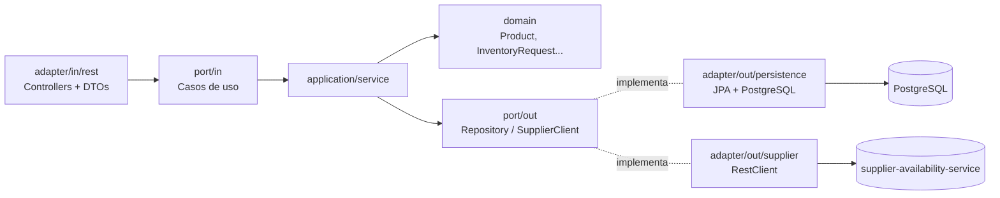
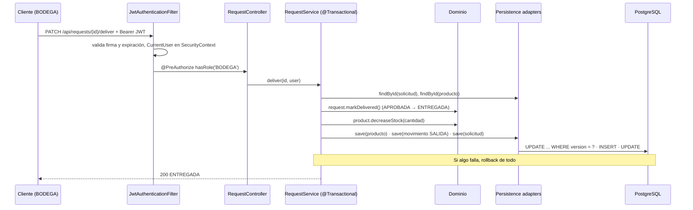
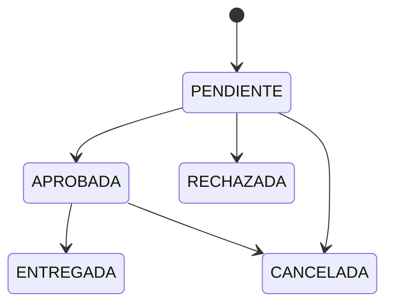

# StockBridge – Gestión de Inventario y Solicitudes Internas

Simulacro Módulo 6 – Java Spring Boot (Arquitectura Hexagonal + JPA + JWT + Observabilidad + Docker + Pruebas).

## Servicios

| Servicio | Puerto | Descripción |
|---|---|---|
| `inventory-management-service` | 8080 | Productos, usuarios, solicitudes y movimientos (hexagonal) |
| `supplier-availability-service` | 8081 | Simula la disponibilidad en proveedores externos (capas simples) |
| `postgres` | 5432 | PostgreSQL 16, esquema con Flyway |

Stack: Java 21, Spring Boot 3.5.6, Maven, PostgreSQL 16, Flyway, Spring Security + JJWT 0.12, MapStruct 1.6,
Lombok, springdoc-openapi, Actuator/Micrometer, JUnit 5, Mockito, Testcontainers.

## Ejecución

### Todo con Docker (un solo comando)
```bash
docker compose up --build
```
Los tres contenedores comparten la red `stockbridge-net`: el servicio principal llama al proveedor como
`http://supplier-service:8081` y a la BD como `postgres:5432` (nombres de servicio, no `localhost`).

Variables de entorno opcionales (tienen valores por defecto en `docker-compose.yml`): `DB_USER`, `DB_PASSWORD`, `JWT_SECRET`
(mínimo 32 caracteres). Puedes ponerlas en un archivo `.env` en la raíz (está en `.gitignore`).

### Local (desarrollo)
```bash
docker compose up -d postgres
cd supplier-availability-service && mvn spring-boot:run
cd inventory-management-service && mvn spring-boot:run
```

- Swagger: http://localhost:8080/swagger-ui.html (login → copiar `token` → botón **Authorize**)
- Health: http://localhost:8080/actuator/health
- Métricas (requiere ADMIN): http://localhost:8080/actuator/metrics

### Usuarios de prueba (V2__seed_data.sql)
| Email | Contraseña | Rol |
|---|---|---|
| admin@stockbridge.com | Admin123* | ADMIN |
| bodega@stockbridge.com | Admin123* | BODEGA |

Los empleados se registran con `POST /auth/register` (rol EMPLEADO por defecto).

## Endpoints

| Método | Ruta | Roles | Descripción |
|---|---|---|---|
| POST | `/auth/register` | público | Registro (EMPLEADO), devuelve JWT |
| POST | `/auth/login` | público | Login, devuelve JWT |
| GET | `/api/products` | autenticado | Listado paginado (`page`, `size`) |
| GET | `/api/products/{id}` | autenticado | Detalle |
| POST | `/api/products` | ADMIN | Alta (código único, precio > 0, stock ≥ 0) |
| PUT | `/api/products/{id}` | ADMIN | Actualizar datos |
| PATCH | `/api/products/{id}/status?active=` | ADMIN | Activar / desactivar |
| GET | `/api/products/low-stock?minimum=` | ADMIN, BODEGA | Productos activos con stock bajo |
| POST | `/api/products/{id}/stock-entries` | ADMIN, BODEGA | Reponer stock (movimiento ENTRADA) |
| GET | `/api/products/{id}/movements` | ADMIN, BODEGA | Trazabilidad de movimientos |
| GET | `/api/products/{id}/supplier-availability?quantity=` | ADMIN, BODEGA | Consulta al proveedor externo |
| POST | `/api/requests` | EMPLEADO | Crear solicitud (producto activo y stock suficiente) |
| GET | `/api/requests/mine` | autenticado | Mis solicitudes |
| GET | `/api/requests` | ADMIN, BODEGA | Todas las solicitudes |
| GET | `/api/requests/{id}` | autenticado | Un EMPLEADO solo puede ver las suyas (403) |
| PATCH | `/api/requests/{id}/approve` | ADMIN, BODEGA | Aprobar (vuelve a verificar stock) |
| PATCH | `/api/requests/{id}/reject` | ADMIN, BODEGA | Rechazar con motivo obligatorio |
| PATCH | `/api/requests/{id}/cancel` | dueño o ADMIN | Cancelar |
| PATCH | `/api/requests/{id}/deliver` | BODEGA | Entregar: descuenta stock + movimiento SALIDA |

Proveedor: `POST http://localhost:8081/api/suppliers/check-availability` con `{"productCode","quantity","category"}`.

## Errores (ProblemDetail, RFC 9457)

| Código | Cuándo |
|---|---|
| 400 | Bean Validation (`errors` con el detalle por campo) |
| 401 | Sin token, token inválido/manipulado/expirado, o credenciales incorrectas |
| 403 | Rol sin permiso o recurso ajeno (empleado consultando otra solicitud) |
| 404 | Producto, solicitud o usuario inexistente |
| 409 | Código/email duplicado, stock insuficiente, transición inválida, modificación concurrente (`@Version`) |
| 422 | Regla de dominio violada (precio ≤ 0, cantidad ≤ 0, producto inactivo, motivo vacío) |
| 503 | Proveedor caído, con error o fuera de tiempo |
| 500 | Error inesperado (se registra con `log.error`) |

## Observabilidad

| Métrica | Tipo | Qué mide |
|---|---|---|
| `inventory.requests.created` / `approved` / `rejected` / `cancelled` / `delivered` | Counter | Solicitudes por operación |
| `inventory.products.low-stock` | Gauge | Productos activos con stock < `app.inventory.low-stock-threshold` (5) |
| `inventory.supplier.requests{outcome}` | Timer | Tiempo de respuesta del proveedor (`success`, `error`, `empty`) |
| `inventory.errors{status, exception}` | Counter | Errores devueltos por la API |

Ejemplo: `GET /actuator/metrics/inventory.errors?tag=status:503` cuenta las caídas del proveedor;
`?tag=status:500` las fallas internas (BD, bugs). Los logs muestran cada operación con `log.info` y las fallas con
`log.error` (por ejemplo `Error consultando proveedor para producto ...`).

## Pruebas
```bash
mvn test                        # unitarias (JUnit 5 + Mockito): dominio y casos de uso
mvn test -Dtest=ApplicationIT   # integración: MockMvc + PostgreSQL real con Testcontainers (requiere Docker)
```
- **Unitarias** (`*Test`): el dominio se prueba sin mocks; los casos de uso simulan los puertos de salida con Mockito
  (producto válido/duplicado, cantidad inválida, producto inactivo, entrega sin stock, transición inválida,
  propiedad del recurso, proveedor caído, login/registro).
- **Integración** (`ApplicationIT`): login, token manipulado, 403 por rol y por recurso ajeno, validación 400 y el
  flujo completo crear → aprobar → entregar comprobando stock y movimiento en la BD real.
- Testcontainers está fijado en 1.21.4: la 1.21.3 que trae Spring Boot 3.5.6 no es compatible con Docker Engine 29.

## Arquitectura hexagonal (inventory-management-service)



```
domain/          -> modelo y reglas puras (sin Spring ni JPA)
application/     -> puertos (in/out) y casos de uso
infrastructure/  -> adaptadores REST, JPA, HTTP, seguridad y configuración
```

### Recorrido de una entrega



## Estados de una solicitud



## Decisiones técnicas
- **Dominio independiente**: las entidades de dominio no tienen anotaciones; las entidades JPA viven en
  `persistence/entity` y MapStruct traduce entre ambas. Cambiar PostgreSQL por otra BD solo toca los adaptadores de
  persistencia y la configuración; dominio, puertos y casos de uso no cambian.
- **Reglas en el dominio**: `Product` impide stock negativo y precio ≤ 0; `InventoryRequest` y `RequestStatus`
  controlan las transiciones. Los casos de uso orquestan (buscar, validar existencia/propiedad, guardar, métricas).
- **Stock en la solicitud**: se verifica al crear (ejemplo del enunciado; si no alcanza → 409 sugiriendo consultar al
  proveedor), al aprobar (el stock pudo cambiar) y al entregar (el dominio impide quedar en negativo).
- **Transacción en la entrega**: descontar stock, registrar el movimiento y marcar ENTREGADA ocurren en un único
  `@Transactional`; si falla el movimiento, el stock no se descuenta.
- **Concurrencia**: `@Version` en `ProductEntity` (bloqueo optimista). Si dos entregas compiten por las últimas
  unidades, la segunda falla con 409 en lugar de dejar stock negativo o perder una actualización.
- **N+1**: `@EntityGraph(attributePaths = {"user","product"})` en los listados de solicitudes. Se detecta con
  `show-sql: true`.
- **Resiliencia**: `RestClient` con timeouts (conexión 2 s, lectura 3 s); cualquier falla del proveedor →
  `SupplierUnavailableException` → 503. `SupplierAvailabilityService` no es `@Transactional` para no retener una
  conexión de BD durante la llamada HTTP.
- **Proveedor determinista**: proveedor, cantidad y días salen de un hash de `productCode + category`; la misma
  consulta responde siempre igual, sin azar ni estado.
- **Seguridad**: JWT stateless firmado con HMAC (uid, rol, expiración). Un token modificado no pasa la verificación
  de firma → 401. Roles con `@PreAuthorize`; la propiedad de la solicitud se valida en el caso de uso.
  Contraseñas con BCrypt. El login responde el mismo mensaje si el email no existe o la clave es incorrecta.
- **Motivo de rechazo separado** (`rejection_reason`, migración V3): no sobrescribe la observación del empleado.
- **Esquema solo con Flyway** (`ddl-auto: validate`): las migraciones aplicadas no se editan; los cambios van en
  una nueva versión.

## Avance
Checklist completo del simulacro: [docs/CHECKLIST.md](docs/CHECKLIST.md)

- [x] Lógica de dominio (`Product`, `InventoryRequest`, `RequestStatus`)
- [x] Casos de uso (`ProductService`, `RequestService`, `StockService`, `AuthService`, `SupplierAvailabilityService`)
- [x] JWT (`JwtTokenProvider`, `JwtAuthenticationFilter`)
- [x] Lógica determinista del proveedor (`AvailabilityService`)
- [x] Métricas: contadores de solicitudes, gauge de stock bajo y contador de errores
- [x] Pruebas unitarias e integración
- [x] Docker Compose con los tres servicios
