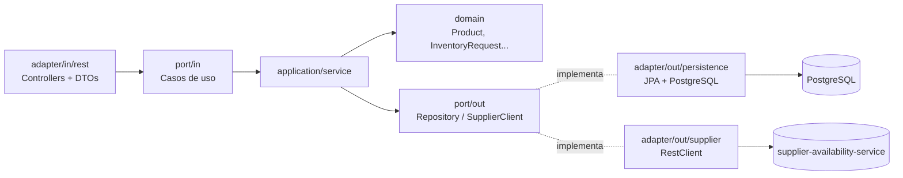
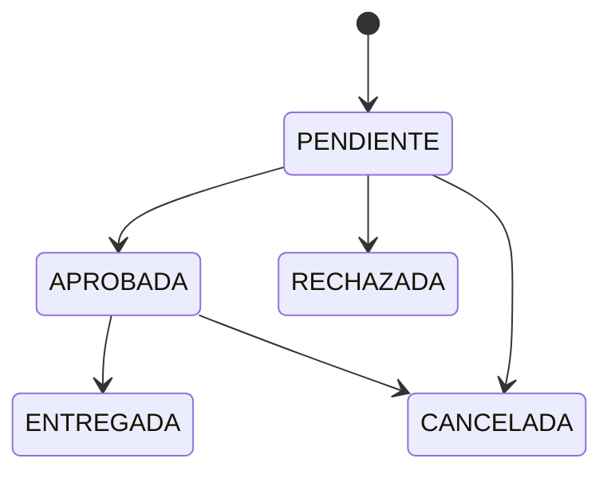

# StockBridge – Gestión de Inventario y Solicitudes Internas

Simulacro Módulo 6 – Java Spring Boot (Arquitectura Hexagonal + JPA + JWT + Observabilidad + Docker + Pruebas).

## Servicios

| Servicio | Puerto | Descripción |
|---|---|---|
| `inventory-management-service` | 8080 | Productos, usuarios, solicitudes y movimientos (hexagonal) |
| `supplier-availability-service` | 8081 | Simula la disponibilidad en proveedores externos |
| `postgres` | 5432 | Base de datos (migraciones con Flyway) |

## Ejecución

### Todo con Docker (un solo comando)
```bash
docker compose up --build
```

### Local (desarrollo)
```bash
docker compose up -d postgres
cd supplier-availability-service && mvn spring-boot:run
cd inventory-management-service && mvn spring-boot:run
```

- Swagger: http://localhost:8080/swagger-ui.html
- Health: http://localhost:8080/actuator/health
- Métricas (ADMIN): http://localhost:8080/actuator/metrics

### Usuarios de prueba (V2__seed_data.sql)
| Email | Contraseña | Rol |
|---|---|---|
| admin@stockbridge.com | Admin123* | ADMIN |
| bodega@stockbridge.com | Admin123* | BODEGA |

Los empleados se registran con `POST /auth/register` (rol EMPLEADO por defecto).

### Pruebas
```bash
mvn test                        # unitarias (JUnit 5 + Mockito)
mvn test -Dtest=ApplicationIT   # integración con Testcontainers (requiere Docker)
```

## Arquitectura hexagonal (inventory-management-service)



```
domain/          -> modelo y reglas puras (sin Spring ni JPA)
application/     -> puertos (in/out) y casos de uso
infrastructure/  -> adaptadores REST, JPA, HTTP, seguridad y configuración
```

## Estados de una solicitud



## Decisiones técnicas
- **Dominio independiente**: las entidades de dominio no tienen anotaciones; las entidades JPA viven en `persistence/entity` y MapStruct traduce entre ambas.
- **Transacción en la entrega**: descontar stock, registrar el movimiento y marcar ENTREGADA ocurren en un único `@Transactional`; si algo falla se hace rollback de todo.
- **Concurrencia**: `@Version` en `ProductEntity` (bloqueo optimista) → 409 si dos entregas compiten.
- **N+1**: `@EntityGraph(attributePaths = {"user","product"})` en los listados de solicitudes.
- **Resiliencia**: `RestClient` con timeouts de conexión/lectura; fallas del proveedor → `SupplierUnavailableException` → 503.
- **Errores**: `ProblemDetail` centralizado en `GlobalExceptionHandler` (400/401/403/404/409/422/503/500).

## TODO
Checklist completo del simulacro: [docs/CHECKLIST.md](docs/CHECKLIST.md)

- [ ] Lógica de dominio (`Product`, `InventoryRequest`, `RequestStatus`)
- [ ] Casos de uso (`ProductService`, `RequestService`, `AuthService`, `SupplierAvailabilityService`)
- [ ] JWT (`JwtTokenProvider`, `JwtAuthenticationFilter`)
- [ ] Lógica determinista del proveedor (`AvailabilityService`)
- [ ] Métricas: contadores de solicitudes y gauge de stock bajo
- [ ] Pruebas unitarias e integración
